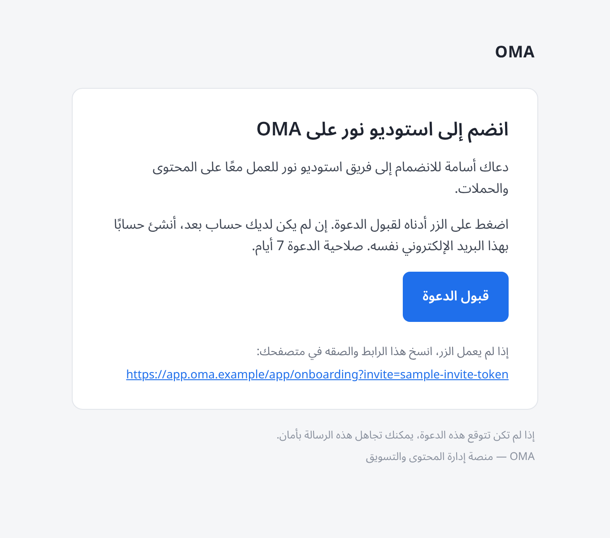
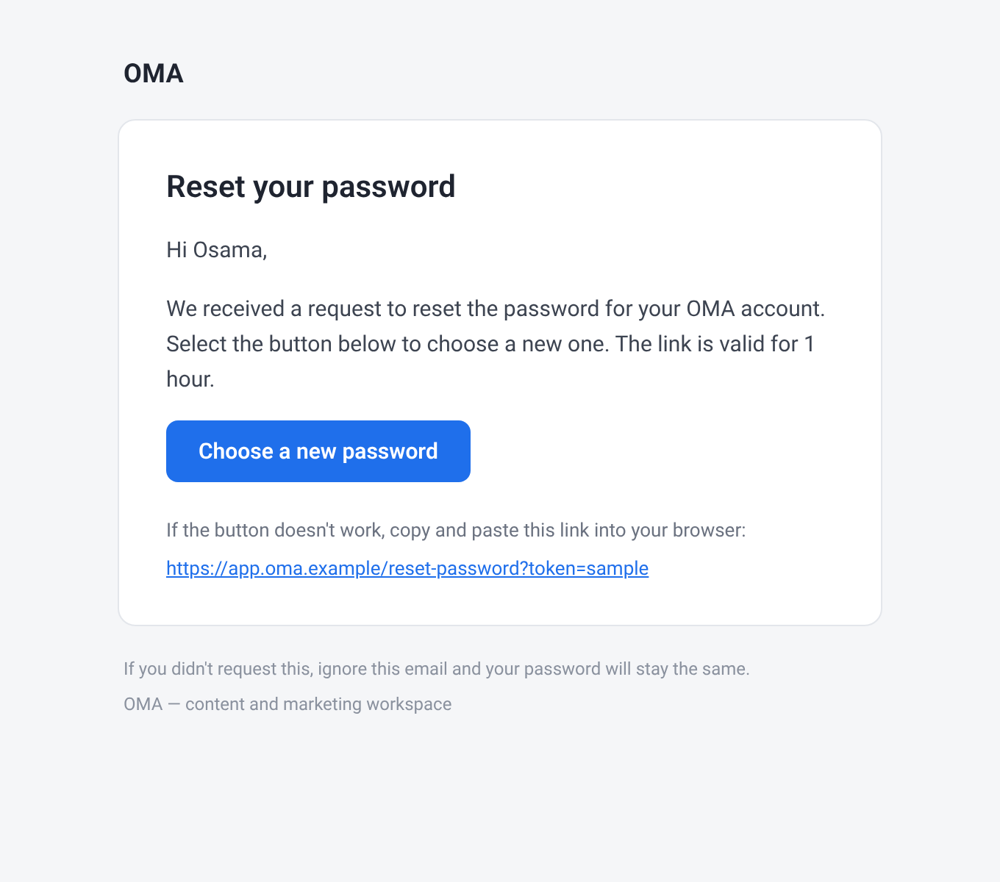
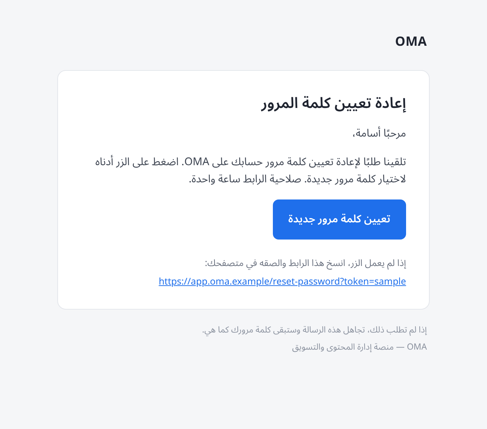

# Email setup (Resend) · إعداد البريد الإلكتروني (Resend)

OMA sends invitation and password-reset emails through [Resend](https://resend.com).
Emails are sent by the **worker** (outbox → BullMQ `mail` queue). The **API** reads the same
settings to tell the UI whether email delivery is configured.

يرسل OMA رسائل الدعوة وإعادة تعيين كلمة المرور عبر [Resend](https://resend.com).
يتولى **الـ worker** الإرسال الفعلي، بينما تقرأ **الـ API** الإعدادات نفسها لتُظهر في الواجهة ما إذا كان البريد مُعدًّا.

---

## English

### 1. Create a Resend account
Sign up at <https://resend.com>.

### 2. Add and verify your domain
1. In Resend → **Domains** → **Add Domain**, enter the domain you send from (a subdomain such as `mail.yourdomain.com` is recommended).
2. Resend shows DNS records. Add them at your DNS provider:
   - **SPF** — a `TXT` record (and an `MX` record on the `send` subdomain) authorising Resend to send for you.
   - **DKIM** — a `TXT` record (`resend._domainkey`) with Resend's public key.
   - **DMARC** (optional, recommended) — a `TXT` record on `_dmarc`, e.g. `v=DMARC1; p=none; rua=mailto:you@yourdomain.com`.
3. Click **Verify**. DNS changes can take from a few minutes up to 48 hours.

### 3. Create an API key
Resend → **API Keys** → **Create API Key**, permission **Sending access** (optionally restricted to your domain). Copy it once; it is shown only once. Never commit it.

### 4. Configure Render
Set these environment variables on **both** the API web service and the worker background service:

| Variable | Example | Required |
|---|---|---|
| `MAIL_PROVIDER` | `resend` | yes |
| `RESEND_API_KEY` | `re_…` (secret) | yes |
| `MAIL_FROM` | `OMA <no-reply@mail.yourdomain.com>` | yes |
| `MAIL_REPLY_TO` | `support@yourdomain.com` | no |
| `WEB_ORIGIN` | `https://app.yourdomain.com` | yes on the worker (links in emails) |

Redeploy both services after saving.

### 5. Testing without a domain
Until your domain is verified you can use `MAIL_FROM=OMA <onboarding@resend.dev>`. Resend's sandbox sender **only delivers to the email address that owns the Resend account**; emails to anyone else are rejected (HTTP 403). Use it for a smoke test only.

### Troubleshooting
- Worker logs `resend rejected the email` with a status and hint: 401/403 → wrong key or unverified domain; 422 → invalid `MAIL_FROM` or recipient.
- If `MAIL_PROVIDER=resend` but the key or sender is missing, the worker logs it at startup and falls back to logging emails instead of sending.
- Failed sends are retried by the queue (5 attempts) and recorded on the job as `MAIL_SEND_FAILED`. The API request that created the invite never fails because of email.
- When email is not configured, the invite dialog says so and shows a secure link to share manually.

---

## العربية

### ١. إنشاء حساب في Resend
سجّل في <https://resend.com>.

### ٢. إضافة النطاق والتحقق منه
1. من **Domains** ← **Add Domain** أدخل النطاق الذي سترسل منه (يُفضّل نطاق فرعي مثل `mail.yourdomain.com`).
2. سيعرض Resend سجلات DNS، أضفها لدى مزوّد DNS:
   - **SPF**: سجل `TXT` (وسجل `MX` على النطاق الفرعي `send`) يسمح لـ Resend بالإرسال باسمك.
   - **DKIM**: سجل `TXT` باسم `resend._domainkey` يحتوي المفتاح العام.
   - **DMARC** (اختياري ومُستحسن): سجل `TXT` على `_dmarc` مثل `v=DMARC1; p=none; rua=mailto:you@yourdomain.com`.
3. اضغط **Verify**. قد يستغرق انتشار DNS من دقائق حتى 48 ساعة.

### ٣. إنشاء مفتاح API
من **API Keys** ← **Create API Key** بصلاحية **Sending access**. انسخ المفتاح فورًا لأنه يظهر مرة واحدة، ولا تضعه في الكود أبدًا.

### ٤. الإعداد على Render
أضف المتغيرات التالية على خدمة **الـ API** وخدمة **الـ worker** كلتيهما:

| المتغير | مثال | إلزامي |
|---|---|---|
| `MAIL_PROVIDER` | `resend` | نعم |
| `RESEND_API_KEY` | `re_…` (سري) | نعم |
| `MAIL_FROM` | `OMA <no-reply@mail.yourdomain.com>` | نعم |
| `MAIL_REPLY_TO` | `support@yourdomain.com` | لا |
| `WEB_ORIGIN` | `https://app.yourdomain.com` | نعم على الـ worker (للروابط داخل الرسائل) |

ثم أعد نشر الخدمتين.

### ٥. التجربة قبل التحقق من النطاق
يمكنك مؤقتًا استخدام `MAIL_FROM=OMA <onboarding@resend.dev>`. هذا المُرسِل التجريبي **يرسل فقط إلى البريد المالك لحساب Resend**، وتُرفض الرسائل لأي عنوان آخر. استخدمه للاختبار فقط.

### حل المشكلات
- يسجّل الـ worker رسالة `resend rejected the email` مع رمز الحالة: 401/403 مفتاح خاطئ أو نطاق غير مُتحقق منه؛ 422 عنوان مُرسِل أو مستلم غير صالح.
- إن كان `MAIL_PROVIDER=resend` دون مفتاح أو مُرسِل، يسجّل الـ worker ذلك ويكتفي بتسجيل الرسائل بدل إرسالها.
- تُعاد محاولة الإرسال الفاشل تلقائيًا (5 محاولات)، ولا يفشل طلب إنشاء الدعوة بسبب البريد.
- عند عدم إعداد البريد، تُظهر نافذة الدعوة ذلك بوضوح مع رابط دعوة آمن للمشاركة يدويًا.

---

## Previews · معاينات

| English | العربية |
|---|---|
|  |  |
|  |  |
